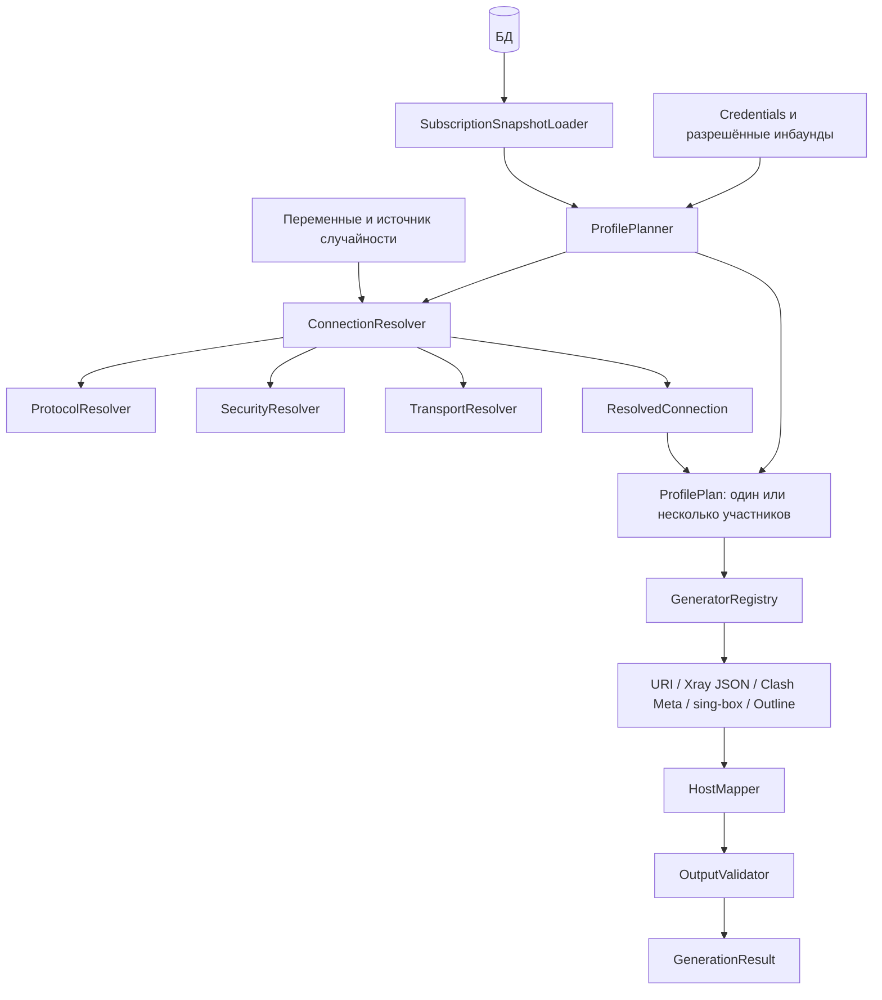

# Хосты и клиентские конфигурации

Хост всегда описывает собственное подключение к одному инбаунду. Связи с другими
хостами добавляют автоматический профиль с балансировкой. Администратор управляет
обоими сценариями через одну форму и один API.

## Данные

| Поле `hosts` | Назначение |
| --- | --- |
| `id` | Стабильный числовой ID |
| `inbound_id` | Инбаунд собственного подключения |
| `remark`, `address` | Примечание и адрес; поддерживаются существующие переменные, CSV и wildcard |
| `port` | Порт подключения; SQL NULL наследует порт инбаунда |
| `enabled` | Разрешение выдавать собственное подключение и профиль владельца |
| `position` | Общий порядок хостов |
| `show_when_composed` | Показывать отдельно при фактическом участии в автоматическом профиле; default true |
| `overrides` | Проверяемые необязательные переопределения подключения; default `{}` |
| `balancer_settings` | Настройки автоматического профиля; SQL NULL означает отсутствие явных настроек |
| `created_at`, `updated_at` | Время в UTC |

Связи хранятся в `host_links(owner_host_id, member_host_id, position)`. Пара ID
уникальна; позиция уникальна внутри владельца; самоссылка запрещена. Удаление хоста
удаляет входящие и исходящие связи. Встречные связи разрешены. Группы и привязки
шаблонов остаются отдельными отношениями.

В API также возвращаются `inbound_tag`, `inbound_port`, `groups`, `subscription_template_ids`,
упорядоченные `linked_host_ids` и `member_of` с ID и примечаниями владельцев.
`inbound_port` отражает текущий порт из конфигурации инбаунда (число или строка
со списком/диапазоном портов; `null`, если в конфигурации порт отсутствует).
В таблице и карточках показывается `port ?? inbound_port`,
при этом наследуемый `port` остаётся `null`.
Состав балансировщика и отдельная видимость настраиваются в форме хоста;
список хостов не выводит их под названием или отдельной колонкой.

## Переопределения

| Раздел | Поля |
| --- | --- |
| `security` | `mode`, `sni`, `keep_sni_blank`, `sni_from_address`, `alpn`, `fingerprint`, `allow_insecure` |
| `transport` | `host`, `path`, `use_sni_as_host`, `random_user_agent`, `xhttp.extra` |
| `mux` | `enabled`, `xray`, `smux`; у smux собственное `enabled` |
| `stream` | Объекты `sockopt`, `final_mask` для Xray |
| `clients` | `clash.ip_version`, `clash.x25519`, `server_description` для Xray/Clash Meta |
| `fragment`, `noise` | Прежние строковые форматы фрагментации и шума |
| `mapper` | Операции `set`, `copy`, `unset` для `xrayJson`, `clash`, `singbox`, `base64` |

Полная актуальная JSON Schema доступна в `GET /api/hosts/capabilities`.
Неизвестные ключи отклоняются, кроме содержимого расширенных объектов socket/final mask.
SNI, пустой SNI и SNI из адреса — взаимоисключающие режимы.

Отсутствие поля при создании означает наследование/default. PATCH сохраняет
пропущенные поля. Внутри объектов PATCH `null` удаляет переопределение, массивы
заменяются целиком. `false`, `0`, путь `""` и ALPN `[]` являются явными значениями.
`overrides: null` очищает все переопределения; `port: null` возвращает порт инбаунда.
Списки связей, групп и привязки шаблонов заменяются целиком.

### XHTTP

Все дополнительные параметры имеют один источник:

```json
{
  "transport": {
    "xhttp": {
      "extra": {
        "scMaxBufferedPosts": 0,
        "xPaddingObfsMode": false,
        "uplinkHTTPMethod": "PUT"
      }
    }
  }
}
```

`extra` атомарен и при PATCH: объект целиком заменяет extra инбаунда, `{}` явно
очищает его, `null` удаляет override и возвращает наследование. Пропущенные ключи
в явном объекте используют defaults клиента. `null` внутри extra запрещён.
HTTP-метод обрезается по краям и переводится в верхний регистр. `GET` допустим
только для packet-up. Совместимость проверяется и при изменении инбаунда.

Xray получает `xhttpSettings.extra`/`splithttpSettings.extra`; URI — JSON в extra;
VMess — объект extra внутри Base64 payload. Clash Meta преобразует поддержанные ключи
в `xhttp-opts`. sing-box исключает неподдерживаемый XHTTP.

### Mapper

`to` задаёт путь внутри одного узла. Для URI это буквальный query-ключ;
для VMess изменяется payload. `copy.from` читает raw inbound или `$host.*`
(`address`, `port`, `finalRemark`, `protocol`, `protocolOptions`, `transport`, `security`, `metadata`).
Поддерживаются пути объектов и массивов; индексы ограничены 1024 элементами.
Отсутствующий источник copy пропускается. Mapper не изменяет полный документ.
Служебный Xray tag менять нельзя. После преобразования проверяются идентификаторы
и ссылки, включая группы и Xray dialer/routing.

## Составные профили

Для A → B, C профиль A содержит A+B+C. Если B → D, профиль A не включает D;
профиль B содержит B+D. Участники используют собственные адреса, инбаунды,
переопределения и credentials соответствующего протокола пользователя.
Выключенные, запрещённые пользователю или несовместимые с форматом подключения
не возвращаются через связи. Отсутствующая привязка формата также исключает участника.

Скрытие отдельного подключения действует только в форматах с выданным
автоматическим профилем. URI/Base64 игнорируют этот флаг. Outline сохраняет прежний
контракт одного SS-объекта. Фильтр групп выбирает владельцев; зависимые участники
не становятся отдельными владельцами за пределами фильтра.

`balancer_settings` содержит `remark`, `strategy`, `probe_url`, `probe_interval`
и `clients`. Связи без настроек используют least-ping defaults. Явные настройки
без связей разрешают профиль с одним собственным подключением.

| Target | Стратегии | Дополнительные настройки |
| --- | --- | --- |
| `v2ray-json` | least_ping, least_load, random, round_robin | enable_concurrency, strategy_settings: expected/max_rtt_ms/failure_tolerance/baselines_ms/costs |
| `clash` | least_ping, round_robin | tolerance, lazy |
| `sing-box` | least_ping | tolerance, idle_timeout, interrupt_existing_connections |

У каждого target также доступны отдельные `strategy`, `probe_url`, `probe_interval`.
Неподдерживаемая общая стратегия требует явного переопределения для включённого
формата. Панель не заменяет её молча. Xray costs ссылаются только на владельца
или прямых участников. При клонировании собственная стоимость получает ID копии.

Обычный профиль использует свой шаблон, автоматический — шаблон владельца.
Полные шаблоны участников не вкладываются. Конфликт шаблонов общей подписки
по-прежнему возвращает 409; отсутствие профилей — 204.

## API

Все операции требуют sudo. Префикс `/api/hosts`.

| Метод | Путь | Назначение |
| --- | --- | --- |
| GET | `` | `items`, `total`; search/groups/inbound_id/enabled/composition/offset/limit |
| POST | `` | Создание, ответ 201 |
| GET, PATCH, DELETE | `/{id}` | Чтение, частичное изменение, удаление (204) |
| POST | `/{id}/clone` | `{remark}`; выключенная копия с исходящими связями (201) |
| POST | `/reorder` | `{host_ids: [...]}`; все ID ровно по одному |
| GET | `/capabilities` | Версия схемы, JSON Schema переопределений/балансировщика, стратегии |
| POST | `/preview` | `{host, host_id?, user_id, target}`; планы и причины исключений, без записи и credentials |

`groups` — строка ID через запятую; максимум `limit` — 1000, по умолчанию 100.
Ошибки: 401/403 — доступ; 404 — ID; 409 — конфликт; 422 — данные или неподдерживаемые параметры.
Хост, связи, группы и шаблоны изменяются одной транзакцией после валидации.

Старые host/v2/bulk и отдельный API балансировщиков удалены.

## Классы и поток данных



`contracts.py` содержит отделённые от ORM dataclass-контракты `HostSnapshot`,
`TemplateSnapshot`, `SubscriptionSnapshot`, `ConnectionInput`, `ResolvedConnection`,
`ProfilePlan`, `RenderInput`, `GenerationResult`. Вложенные словари копируются.
`ProtocolResolver` проверяет существующие credentials без создания новых ID.
Соединение разрешается один раз на хост в пределах планирования запроса.

Генератор получает `RenderInput(target, profiles, defaults, external_config, reverse, as_base64)`.
Каждый план содержит владельца, подключения, полный шаблон и эффективные настройки
балансировки. Генератор не читает БД/runtime settings. Существующие низкоуровневые
кодировщики используются как обычные классы; отдельной ветки старых балансировщиков нет.

## Перенос и выпуск

Ревизия `a319d48e7062` следует за `f6a82c1d5e90`. SQLite требует версию 3.35+.
Перед upgrade необходима полная резервная копия: старые scalar-колонки и таблицы
балансировщиков удаляются. Выполнить preflight на копии старой БД:

```powershell
.venv/Scripts/python.exe scripts/host_preflight.py --database-url sqlite:///backup.db
.venv/Scripts/python.exe -m alembic upgrade head
```

Preflight не пишет данные, возвращает JSON с errors/warnings и mapping старых
балансировщиков по форматам: источник собственного подключения, участники и состояние.
Миграция повторяет preflight перед DDL. Пустые балансировщики и оборванные связи
останавливают перенос до изменения схемы.

Существующие ID, группы, привязки и видимость обычных хостов сохраняются. Старые
балансировщики получают владельцев-копии первого совместимого участника. При разных
наборах участников по форматам создаются отдельные владельцы. Они скрыты отдельно,
не включены в URI/Outline; исходные хосты остаются. Отключённые участники сохраняются
в связях и фильтруются при генерации. Перенос прежних scalar-XHTTP overrides
фиксирует эффективный extra снимком; это отмечается в отчёте.

Обычные представимые хосты поддерживают downgrade/re-upgrade. Составные профили,
новые параметры и значения, которые старая схема теряет, блокируют downgrade
до DDL. Для таких установок откат выполняется восстановлением резервной копии.

SQLite upgrade/downgrade/re-upgrade и перенос данных покрыты тестами; MySQL/MariaDB
проверены компиляцией DDL, без интеграционного запуска сервера. Бинарники Xray,
Mihomo и sing-box в этом окружении не использовались для проверки документов.
Окончательную совместимость с версиями клиентских ядер следует проверять на стенде выпуска.

## Объединение YAML-форматов

Ревизия `c82a6f0159bd` следует за `b57c20e91a46` и переносит сохранённый формат
`clash-meta` в `clash`, сохраняя ID, содержимое, defaults и привязки шаблонов.
Ключи `overrides.clients`, `overrides.mapper` и `balancer_settings.clients`
используют только `clash`. Имена `clash-meta` и `mihomo` не принимаются в API,
привязках шаблонов и URL подписки. Распознавание приложения Mihomo по User-Agent
сохраняется: оно выбирает формат `clash`.
Общий `clash_settings` и ключ `clash` внутри глобального mux-шаблона остаются
настройками низкоуровневого кодировщика, а не отдельным форматом.

Предыдущая ревизия `b57c20e91a46` объединяет старые настройки Clash/Mihomo,
отклоняя противоречивые значения до DDL. Новая ревизия переименовывает ключи
без изменения значений и также отклоняет конфликт, если старый и новый ключи
уже присутствуют с разными данными. Downgrade новой ревизии возвращает `clash-meta`.
Миграции проверяются на SQLite с выключенными и включёнными FK, включая
сохранение привязок, конфликты и upgrade/downgrade/re-upgrade.

Форма хранит параметры балансировщика типизированными объектами. JSON используется
только в редакторах расширенных параметров и массивов least-load. Ошибки массивов
показываются возле поля. Удаление клиентской опции отправляет PATCH с `null`;
значения `0` и `false` сохраняются. Стрелки общего порядка из строк и карточек
удалены; порядок строк на desktop меняется перетаскиванием.

Frontend-проверки формы запускаются из `app/dashboard`:

```powershell
npm.cmd exec --yes --package=tsx@4.20.5 -- tsx --test tests/host-form.test.ts
```
