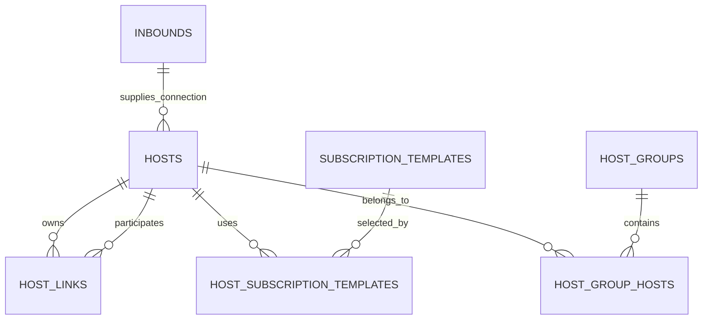
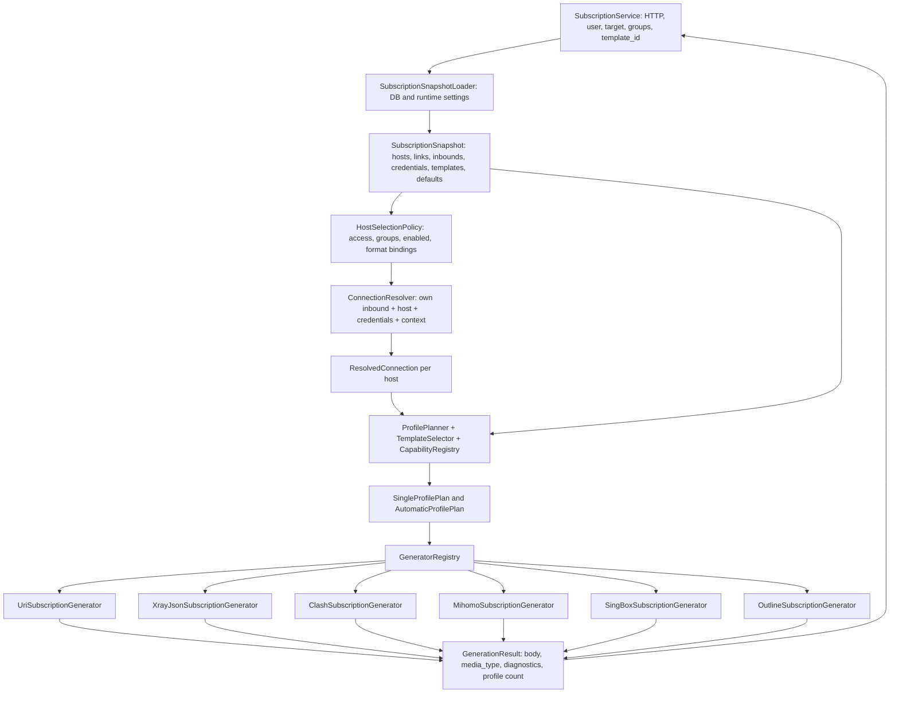

# Переработка хостов и генерации клиентских конфигураций

Дата исходного плана: 2026-10-21. Последнее уточнение: 2026-10-23.
Реализовано в ветке `codex/host-generation-redesign` с последующими изменениями:
балансировка настраивается в шаблонах через `marzban`, связей и настроек
балансировки в хосте нет. YAML использует единый формат `clash`, без алиасов
`clash-meta` и `mihomo`. Миграции разработки объединены в `e5c14a9d72b0`:
прямой переход от схемы `master` (`f6a82c1d5e90`) к текущей модели.
Канонические форматы: `v2ray`, `v2ray-json`, `clash`, `sing-box`, `outline`.
Алиасы `json`, `xray-json`, `singbox`, `clash-meta`, `mihomo` не принимаются.
Флаг `is_hidden` называется «Скрыть из списка» и исключает отдельное подключение
из всех форматов подписок, включая URI/Base64 и Outline. Возможность использовать
скрытые источники в составных шаблонах сохраняется.
Дальнейшие упоминания связей и параметров балансировки в хосте, раздельных
Clash/Mihomo, исключений скрытия для URI/Outline и промежуточных миграций отражают исходный план.
Актуальные контракты и порядок переноса: [hosts.md](../hosts.md) и
[subscription-templates.md](../subscription-templates.md).
Примеры классов ниже являются архитектурным псевдокодом.
Интеграция миграции с MySQL/MariaDB и проверка документов бинарниками клиентских
ядер требуют отдельного окружения; они не заменены результатами SQLite-тестов.
Редакция 3: все дополнительные параметры XHTTP, включая `scMaxBufferedPosts`,
`xPaddingObfsMode` и `uplinkHTTPMethod`, задаются только в
`overrides.transport.xhttp.extra`; отдельные поля для них исключены.

## 1. Результат и принятые решения

Администратор создаёт обычный хост, выбирая инбаунд, адрес и порт. Если нужны особые
параметры, добавляет только соответствующие поля. Если нужны несколько подключений
в автоматическом профиле, связывает этот хост с другими хостами и задаёт параметры
балансировщика. Все подключения проходят один и тот же resolver и генератор формата.

Решения уточнены с пользователем через интервью `grill-me`:

| Вопрос | Зафиксированное решение |
| --- | --- |
| Отдельный тип составного хоста | Не нужен: любой обычный хост может ссылаться на другие хосты |
| Состав A при связях A → B,C | Собственное подключение A плюс собственные подключения B и C |
| Параметры участников | У каждого свой инбаунд, адрес, порт и переопределения |
| Отдельное отображение | Флаг у каждого хоста, default `true`; распространяется и на владельца A |
| A → B и B → C | В профиле A только A,B; в профиле B только B,C; рекурсивного раскрытия нет |
| URI/Base64 и Outline | Составной профиль не создаётся; доступные обычные подключения выдаются независимо от флага отдельного отображения |
| Перенос старых данных | Обязателен; сохраняются исходные хосты и настройки |
| Старый административный API | Можно заменить сразу; переходные адаптеры не требуются |
| Перенос старых балансировщиков | Создать отдельного владельца, скопировав подключение первого участника; остальных связать с ним; исходные хосты оставить видимыми |
| Различия стратегий клиентов | Добавить дополнительные параметры балансировщика в хост и возможность редактирования в UI |
| Remnawave | Взять архитектуру и необходимые параметры; сохранить возможности MarzbanNext, включая VMess и Outline |
| Дополнительные параметры XHTTP | Все дополнительные параметры, включая scMaxBufferedPosts, xPaddingObfsMode и uplinkHTTPMethod, хранятся только внутри transport.xhttp.extra |

Остальные правила ниже — конкретные проектные предложения этого плана. Они не являются
описанием уже работающих возможностей и не означают побайтового клонирования Remnawave.

## 2. Основания и текущее состояние

Основные источники проекта:

- [PRODUCT.md](../../PRODUCT.md): аудитория, сущности, права, ограничения продукта.
- [Каталог шаблонов](../subscription-templates.md): пять семейств, привязки по ID,
  явное выключение формата, общий шаблон, ответы 204/409/422.
- [Спецификация Remnawave](../subscriptions/README.md) и [общий resolver](../subscriptions/common.md).
- [Xray JSON](../subscriptions/xray-json.md), [URI](../subscriptions/xray-base64.md),
  [Clash](../subscriptions/clash.md), [Mihomo](../subscriptions/mihomo.md),
  [sing-box](../subscriptions/singbox.md), [Stash](../subscriptions/stash.md).

Спецификации Remnawave закреплены за backend 3.4.5, коммитом
`010b365ab1fabea01192b5e6ade4e98e66ee1dbd`. Это материал для проектирования,
а не свидетельство наличия всех перечисленных функций в MarzbanNext.

| Текущая область | Реализация | Что меняется |
| --- | --- | --- |
| Хосты | `app/db/models/proxies.py`, `app/db/crud/proxy_hosts.py` | Одна модель хоста с направленными связями |
| Балансировщики | `app/db/models/settings.py`, `app/db/crud/subscription_balancers.py` | Отдельная сущность заменяется настройками и связями хоста |
| Модели API | `app/models/proxy.py`, `app/models/settings.py` | Типизированные дополнительные параметры и частичное обновление |
| HTTP и сервисы | `app/routers/system.py`, `app/services/system_service.py`, `app/services/settings_service.py` | Единый административный API хостов |
| Сборка подписки | `app/subscription/share.py` | Разделение загрузки, отбора, разрешения параметров, планирования и генерации |
| Генераторы | `v2ray.py`, `clash.py`, `singbox.py`, `outline.py` | Единый входной контракт; генераторы без чтения БД и глобальных настроек |
| HTTP подписок | `app/services/subscription_service.py` | Сохранение URL/заголовков; один вызов нового pipeline |
| Форма | `app/dashboard/src/pages/hosts-page/components/host-dialog/` | Общие поля плюс динамический реестр дополнительных полей |

Сейчас `_process_inbounds_and_tags()` читает БД, выбирает шаблоны, разрешает параметры,
фильтрует участников и управляет генераторами через `isinstance`. Параметры одного
подключения передаются через словарь, похожий на серверный инбаунд.

У текущих стратегий есть разные фактические результаты: Xray получает выбранную
стратегию; sing-box создаёт `urltest`; Clash создаёт `load-balance/round-robin` только
для `round_robin`, остальные стратегии превращает в `url-test`.

В форме `x_padding_obfs_mode` местами преобразуется через truthiness, поэтому явное
`false` теряется. Новая модель должна различать `false`, `0`, `null` и отсутствие ключа.

## 3. Единая модель хоста

### 3.1. Логическая схема



`host_links.owner_host_id=17, member_host_id=23` означает: в автоматический профиль
хоста 17 включить **собственное подключение** хоста 23. Профили, которыми владеет 23,
по этой связи не раскрываются. Владелец 17 добавляется в свой профиль неявно,
поэтому хранить связь 17 → 17 не нужно и запрещено.

Группа хостов остаётся средством организации и фильтрации подписки. Связь хостов —
состав конкретной автоматической конфигурации. Эти сущности не объединяются.

### 3.2. Новая таблица `hosts`

Для поиска, связей и порядка используются обычные SQL-колонки. Разреженные параметры
соединения и балансировщика хранятся в двух JSON-колонках с фиксированными Pydantic-схемами.
Это не произвольный JSON: неизвестные ключи отклоняются; типы, диапазоны и сочетания
проверяются backend. JSON нельзя использовать вместо реляционной таблицы связей.

| Поле | Тип / default | Назначение |
| --- | --- | --- |
| `id` | Integer, PK | Стабильный ID; существующие ID сохраняются |
| `inbound_id` | Integer, FK, NOT NULL | Источник протокола, транспорта и security собственного подключения |
| `remark` | String(256), NOT NULL | Примечание/отображаемое имя; сохраняется текущий синтаксис переменных |
| `address` | String(256), NOT NULL | Внешний адрес собственного подключения; сохраняются существующие CSV, wildcard и переменные |
| `port` | Integer, NULL | Явный внешний порт 1–65535; NULL означает порт инбаунда |
| `enabled` | Boolean, NOT NULL, true | Доступность хоста и его собственного автоматического профиля; выключенный хост не используется и как участник |
| `position` | Integer, NOT NULL, 0 | Глобальный порядок хостов; сортировка `(position, id)` |
| `show_when_composed` | Boolean, NOT NULL, true | Показывать собственное подключение отдельно, если оно включено в реально сформированный составной профиль этого ответа |
| `overrides` | JSON, NOT NULL, `{}` | Только заданные переопределения клиентского подключения; подробности ниже |
| `balancer_settings` | JSON, NULL | Настройки собственного автоматического профиля; NULL при отсутствии настроенной композиции |
| `created_at` | DateTime UTC, NOT NULL | Дата создания; для старых строк дата миграции, без выдуманной истории |
| `updated_at` | DateTime UTC, NOT NULL | Изменение полей, привязок, групп или состава; обновляется в общей транзакции |

`inbound_tag`, `groups`, `subscription_template_ids`, `linked_host_ids`, `member_of`
возвращаются API как связанные или вычисляемые данные и не дублируются SQL-колонками.
`member_of` содержит только ID и примечания владельцев, без рекурсивных объектов.

В БД и API используется положительное `enabled`; старое `is_disabled` переносится
инверсией. Нет `kind=balanced`, отдельного обязательного адреса балансировщика или
копий пользовательских UUID/паролей в строке хоста.

### 3.3. Таблица `host_links`

| Поле | Тип | Назначение |
| --- | --- | --- |
| `owner_host_id` | Integer, FK → hosts.id | Хост, чей автоматический профиль настраивается |
| `member_host_id` | Integer, FK → hosts.id | Дополнительное собственное подключение |
| `position` | Integer, NOT NULL | Порядок дополнительных участников после владельца |

Первичный ключ `(owner_host_id, member_host_id)`, индекс `(member_host_id)`, уникальный
порядок `(owner_host_id, position)`, проверка `owner_host_id != member_host_id`.
Оба FK используют удаление связей при удалении хоста. Перестановка позиций выполняется
через промежуточный диапазон, чтобы не нарушать уникальность во время swap.

Один участник может входить в несколько профилей. Встречные связи A → B и B → A
разрешены: это два независимых профиля A+B и B+A, без рекурсии. Повтор участника
в одном списке отклоняется. Отсутствующий ID отклоняется до изменения БД.

Удаление участника удаляет его связи, но не владельцев. Если удалена последняя
исходящая связь, настроенный автоматический профиль остаётся с собственным
подключением владельца и получает предупреждение в preview. Это позволяет сохранить
и старые балансировщики с одним участником. Профиль существует при непустых связях
или явно заданном `balancer_settings`; обычный хост без обоих признаков его не создаёт.
Удаление всего блока балансировки явно очищает и настройки, и исходящие связи.

### 3.4. `overrides`: какие параметры хранит хост

Ключи ниже опциональны. Пропущенный ключ не создаёт переопределения. Названия полей
API — snake_case. Исключение — содержимое `transport.xhttp.extra`: здесь используются
исходные имена XHTTP-параметров: `scMaxBufferedPosts`, `xPaddingObfsMode`, `uplinkHTTPMethod`.
Преобразования в поля других клиентских форматов выполняют соответствующие генераторы.

| Путь | Тип | Ответственность / значение без переопределения |
| --- | --- | --- |
| `security.mode` | `tls` / `none` | Переопределение security инбаунда; отсутствие сохраняет исходный TLS/Reality/none |
| `security.sni` | string | Явный SNI, включая существующие списки/wildcard |
| `security.sni_from_address` | bool | Взять SNI из уже выбранного адреса; default false |
| `security.alpn` | string[] | ALPN; отсутствие наследует инбаунд, `[]` явно очищает список |
| `security.fingerprint` | string | Отпечаток TLS; отсутствие — инбаунд, затем существующий default генератора |
| `security.allow_insecure` | bool | Явно включить или выключить отключение проверки сертификата; отсутствие наследует |
| `transport.host` | string | HTTP Host / authority по правилам транспорта |
| `transport.path` | string | Path или gRPC service name; `""` — явное пустое значение |
| `transport.use_sni_as_host` | bool | Использовать разрешённый SNI как Host; default false |
| `transport.random_user_agent` | bool | Существующий случайный User-Agent; default false |
| `transport.xhttp.extra` | `XhttpExtra` object | Единый объект всех дополнительных клиентских XHTTP-параметров, включая scMaxBufferedPosts, xPaddingObfsMode и uplinkHTTPMethod; целиком заменяет inbound extra |
| `stream.sockopt` | typed JSON object | Клиентские socket options, только для поддерживающих генераторов |
| `stream.final_mask` | typed JSON object | Клиентский finalmask; при отсутствии используется допустимое значение инбаунда |
| `mux.enabled` | bool | Существующее включение mux; default false |
| `mux.xray` | typed JSON object | Параметры Xray mux вместо скрытого чтения глобального шаблона генератором |
| `mux.smux` | typed JSON object | Параметры multiplex для совместимых клиентов; отдельный `enabled`, не truthiness объекта |
| `fragment` | string | Существующий формат `length,interval,packets`; валидация и генерация сохраняются |
| `noise` | string | Существующая строка шума с текущей валидацией |
| `clients.mihomo.ip_version` | enum | IP-version конкретного клиента; отсутствие — клиентский default |
| `clients.mihomo.x25519` | bool | Специализированный клиентский флаг из спецификации; только для проверенного target |
| `clients.server_description` | string | Описание для поддерживающих клиентов, кодирование на стороне генератора |
| `mapper` | typed object | Упорядоченные операции set/copy/unset по конкретным генераторам; отдельный этап ниже |

Базовые поля `XhttpExtra` имеют следующий контракт:

| Ключ внутри `extra` | Тип | Значение |
| --- | --- | --- |
| `scMaxBufferedPosts` | int >= 0, optional | Максимум буферизованных POST-запросов; явный 0 сохраняется |
| `xPaddingObfsMode` | bool, optional | Режим обфускации padding; явный false сохраняется |
| `uplinkHTTPMethod` | HTTP token, optional | Удаление крайних пробелов и нормализация в верхний регистр; GET разрешён только для XHTTP packet-up |

Пример хранения и передачи:

```json
{
  "overrides": {
    "transport": {
      "xhttp": {
        "extra": {
          "scMaxBufferedPosts": 0,
          "xPaddingObfsMode": false,
          "uplinkHTTPMethod": "PUT"
        }
      }
    }
  }
}
```

У этих значений один источник: `extra`. Они не дублируются соседними полями,
aliases API или отдельными свойствами `ResolvedConnection`. `TransportResolver`
разрешает единый `XhttpExtra`, а builder берёт значения только из него. Для Xray
JSON они формируют XHTTP extra, для URI — соответствующий JSON в параметре extra;
преобразования других поддерживаемых клиентов остаются в их builders.

Отсутствие `extra` или его значение NULL означает наследование объекта инбаунда.
Явный объект, включая `{}`, заменяет его целиком; неявного deep merge нет.
Следовательно, пропущенный ключ внутри явно заданного объекта не наследуется
отдельно из инбаунда: используется поведение клиента для отсутствующего ключа.
При наличии указанных ключей их значения проверяются без truthiness-преобразований;
NULL вместо int/bool/HTTP token отклоняется. Для удаления ключа передаётся новый объект без него,
для возврата наследования всего extra — `extra: null`.

Валидация `uplinkHTTPMethod` выполняется по вложенному пути extra: после trim строка
должна быть непустым HTTP token, затем переводится в верхний регистр. Проверка GET
использует effective XHTTP mode инбаунда и сохраняет ограничение `packet-up`.
XHTTP extra допустим только у XHTTP-инбаунда, с сохранением существующего alias
`splithttp`. Ошибка указывает путь `overrides.transport.xhttp.extra.uplinkHTTPMethod`;
смена инбаунда также повторно проверяет совместимость сохранённого значения.

В первую очередь переносится **весь существующий набор**, включая минимальную схему
`XhttpExtra` для всех трёх параметров. Остальные поля extra, `sockopt`, `final_mask`,
расширенный mux, client options и mapper добавляются после проверки их схем/тестов
соответствующего генератора в рамках этапа 6.
Не показывать в UI параметры, которые backend ещё не умеет применять.

Явный `sni`, включая пустую строку, и `sni_from_address` взаимоисключающие.
Для пустого SNI используется обычное поле `sni: ""` без отдельного флага.
Обычный приоритет: явный SNI → SNI инбаунда → предусмотренный текущим поведением default.
Автоматическое добавление новых fallback на домен из Remnawave не включать без теста
и явного описания изменения: это не требуется для архитектурного переноса.

Протокол и транспорт не становятся свободно редактируемыми полями хоста: они берутся
из инбаунда. Серверные private keys не записываются в `overrides` и не попадают в выдачу.
Публичные Reality-параметры вычисляются resolver/crypto helper из разрешённых данных.

### 3.5. `balancer_settings`: дополнительные поля балансировщика

Настройки относятся к автоматическому профилю **владельца**, а не к соединениям участников.
Их не нужно копировать в каждый связанный хост. Это поля JSON-колонки таблицы `hosts`,
с отдельными типами `BalancerSettings`, `XrayBalancerOptions`, `YamlBalancerOptions`,
`SingBoxBalancerOptions` и формами UI.

| Путь | Тип / default | Назначение |
| --- | --- | --- |
| `remark` | string / NULL | Имя автоматического профиля; NULL → разрешённое примечание владельца + ` · Auto` |
| `strategy` | enum / `least_ping` | Общая стратегия: least_ping, least_load, random, round_robin |
| `probe_url` | http(s) URL / `https://www.gstatic.com/generate_204` | Адрес проверки через клиентские подключения; панель сама не запускает проверки |
| `probe_interval` | seconds, 10–86400 / 300 | Интервал проверки; преобразуется в duration каждого клиента |
| `clients.<target>.strategy` | supported enum / absent | Явная стратегия конкретного генератора; отсутствие наследует общую только при совместимости |
| `clients.<target>.probe_url` | URL / absent | Переопределение URL для клиента |
| `clients.<target>.probe_interval` | seconds / absent | Переопределение интервала для клиента |
| `clients.v2ray-json.enable_concurrency` | bool / true | Параллельность проверок в генерируемом observatory |
| `clients.v2ray-json.strategy_settings` | `LeastLoadOptions` / absent | Дополнительные настройки least_load; отклоняются при другой стратегии |
| `clients.v2ray-json.strategy_settings.expected` | int >= 1 / absent | Количество лучших выходов, между которыми выбирает least_load |
| `clients.v2ray-json.strategy_settings.max_rtt_ms` | milliseconds > 0 / absent | Предельный RTT; преобразуется в Xray maxRTT duration |
| `clients.v2ray-json.strategy_settings.failure_tolerance` | number 0..1 / absent | Допустимая доля ошибок проверок; не путать с допуском задержки YAML/sing-box |
| `clients.v2ray-json.strategy_settings.baselines_ms` | milliseconds[] / absent | Пороги отклонения RTT, преобразуемые в baselines duration |
| `clients.v2ray-json.strategy_settings.costs` | `{host_id, value > 0}[]` / absent | Стоимость выбора участника; host_id преобразуется в его сгенерированный tag, без ручного regex |
| `clients.clash.tolerance` | milliseconds >= 0 / absent | Допуск задержки для url-test, если поддерживается выбранным target |
| `clients.clash.lazy` | bool / absent | Клиентское управление отложенными проверками |
| `clients.mihomo.tolerance` | milliseconds >= 0 / absent | Допуск url-test для Mihomo |
| `clients.mihomo.lazy` | bool / absent | Отложенные проверки Mihomo |
| `clients.sing-box.tolerance` | milliseconds >= 0 / absent | Допуск переключения URLTest |
| `clients.sing-box.idle_timeout` | seconds > 0 / absent | Таймаут неактивности URLTest |
| `clients.sing-box.interrupt_existing_connections` | bool / absent | Прерывать существующие подключения при смене выбранного выхода |

`<target>` — `v2ray-json`, `clash`, `mihomo`, `sing-box`. Это **генераторы**, а не новые
семейства шаблонов: Mihomo продолжает использовать семейство `clash`.
Клиентские параметры не пересылаются вслепую между форматами.

Перечисленные параметры включаются в реализацию с отдельными UI-полями и проверкой
закреплённой версии клиента. Для Xray least_load задана конкретная API-структура;
на стороне builder она преобразуется в поля клиента. Стоимости могут ссылаться
только на владельца или прямых участников; после фильтрации недоступных участников
их стоимости также исключаются. Нельзя переопределять `tag`, `selector` и `outbounds`
произвольным JSON: эти ссылки формирует pipeline.

Стратегия клиента задаётся явно, если общая для него недоступна. Например:

```json
{
  "strategy": "round_robin",
  "probe_url": "https://www.gstatic.com/generate_204",
  "probe_interval": 300,
  "clients": {
    "v2ray-json": {"strategy": "round_robin"},
    "mihomo": {"strategy": "round_robin"},
    "clash": {"strategy": "least_ping"},
    "sing-box": {
      "strategy": "least_ping",
      "tolerance": 50,
      "idle_timeout": 1800,
      "interrupt_existing_connections": false
    }
  }
}
```

При несовместимой общей стратегии и отсутствии явного варианта для включённого
генератора сохранение возвращает 422 с путём поля. UI предлагает выбрать поддерживаемую
стратегию или исключить семейство формата. Изменение привязок шаблонов также проверяет
этот контракт. Не заменять round_robin на least_ping незаметно.

## 4. Отсутствие поля, NULL и явные значения

| Вход | Создание | PATCH |
| --- | --- | --- |
| Дополнительный ключ отсутствует | Не хранить override; применить источник/default при генерации | Сохранить прежний override |
| Ключ override = null | Не хранить override | Удалить override, снова наследовать |
| `false`, `0`, `""`, `[]` | Сохранить, если это допустимое значение данного поля | Сохранить точное значение |
| `overrides = null` | Эквивалент `{}` | Сбросить все overrides |
| `overrides = {}` | Нет overrides | Ничего не менять; объект PATCH применяется по листовым ключам |
| `transport.xhttp.extra` отсутствует | Наследовать extra инбаунда | Сохранить текущий override extra |
| `transport.xhttp.extra = null` | Наследовать extra инбаунда | Удалить override extra и вернуть наследование |
| `transport.xhttp.extra = {}` | Явно пустой extra без наследования | Полностью заменить override пустым объектом |
| `transport.xhttp.extra = {...}` | Использовать только переданный объект | Полностью заменить override extra, сохраняя 0/false |
| `linked_host_ids` отсутствует | `[]` | Сохранить состав |
| `linked_host_ids = []` | Нет дополнительных участников; явные balancer_settings могут создать профиль только владельца | Удалить связи; существующие настройки сохраняют автоматический профиль владельца |
| `balancer_settings = null` при непустых итоговых связях | Использовать фиксированные defaults | Сбросить настройки к фиксированным defaults, сохранив связи |
| `balancer_settings = null` и итоговые связи пусты | Обычный хост без композиции | Удалить настройки и автоматический профиль |
| `subscription_template_ids` отсутствует | Снимок текущих defaults | Сохранить привязки |
| `subscription_template_ids = {}` | Все форматы выключены | Выключить все форматы |
| `subscription_template_ids = null` | 422 | 422 |

`linked_host_ids=null`, `enabled=null`, `show_when_composed=null` отклоняются.
`port=null` остаётся допустимым способом вернуть наследование порта инбаунда.
Пустой адрес и пробельное примечание не допускаются.

При добавлении непустых связей backend фиксирует defaults, если настроек ещё нет.
Объект `balancer_settings={}` при создании явно включает настройки с defaults;
при PATCH ничего не меняет в уже настроенном объекте. Его вложенные ключи также
обновляются по листьям; NULL удаляет client-specific override. NULL общего поля
возвращает его фиксированный default. Валидация выполняется над итоговым объектом.

PATCH реализуется отдельной моделью с `model_fields_set` и `exclude_unset=True`,
а не наследованием всех обязательных полей создания. Нормализация не использует
`value or fallback` для булевых, числовых и допускающих пустую строку полей.
Правило PATCH по листовым ключам имеет явное исключение: `transport.xhttp.extra`
считается одним значением и заменяется целиком. Это единое правило API и resolver,
а не разные способы объединения одного объекта на двух этапах.

Приоритет соединения: **явный override хоста → разрешённое значение его инбаунда →
зафиксированный default генератора/настройки**. Полный клиентский шаблон поставляет
локальные inbounds, DNS и routing, а не внешний адрес сервера.

## 5. Выбор хостов и составление профилей

### 5.1. Обычный пример

```text
A: VLESS + Reality, a.example.com:443, links=[B,C], show_when_composed=true
B: Trojan + TLS,   b.example.com:443, links=[],    show_when_composed=false
C: VMess + WS,     c.example.com:8443, links=[],   show_when_composed=true

Xray JSON: [обычный A] [автоматический A+B+C] [обычный C]
URI:       [ссылка A] [ссылка B] [ссылка C]
```

В YAML/sing-box обычные и составные варианты находятся внутри одного документа:
конкретные proxy/outbound участников создаются один раз, а главный selector получает
A, автоматическую группу A+B+C и C. B присутствует как технический участник,
но отдельно в главном selector не показывается. Его параметры всё равно находятся
в клиентской конфигурации: флаг отображения не является защитой секретов.

### 5.2. Порядок pipeline

1. Проверить подписку/пользователя существующими средствами и определить target.
2. Одним набором запросов загрузить snapshot хостов, связей, инбаундов, шаблонов,
   пользовательских протокольных credentials и настроек генераторов.
3. Проверить `enabled`, доступ пользователя к каждому инбаунду и исключённые инбаунды.
4. Определить корневые хосты по фильтру групп. Связанные участники могут быть вне
   выбранной группы: группа выбирает профиль, а не обрезает его явный состав.
   Но она никогда не отменяет права пользователя и выключение формата у участника.
5. Проверить привязки требуемого семейства у владельца и каждого участника. Нет
   привязки — нет выдачи в этом формате ни отдельно, ни внутри композиции.
6. Разрешить каждое собственное подключение один раз на запрос: пользовательские
   credentials + его инбаунд + его overrides + переменные/время/случайность.
7. Применить матрицу возможностей target к каждому подключению и стратегии.
8. Для каждого выбранного владельца с композицией создать плоский список:
   `[owner, *direct_members_in_link_order]`. Недоступные участники исключаются
   с диагностикой для административного preview, без раскрытия их данных клиенту.
9. Создать обычные и автоматические `ProfilePlan`, затем выбрать шаблоны.
10. Только после успешного планирования вычислить участие в реально выдаваемых
    композициях и применить `show_when_composed` к отдельным вариантам.
11. Передать планы генератору, проверить ссылки/структуру и сериализовать ответ.

Корневой владелец должен быть доступен пользователю и включён. Если его собственное
подключение несовместимо с target, его автоматический профиль в этом target не
создаётся; нельзя незаметно превратить A+B+C в профиль только B+C. Несовместимый
дополнительный участник может исключаться. Это правило показывается в preview.

Если после фильтрации остался один доступный владелец, автоматический профиль с
одним выходом допустим: состав может зависеть от прав пользователя или быть перенесён
из старого одноэлементного балансировщика. Если нет ни одного подключения — профиль
не выдаётся. Обычный хост без связей и без явных настроек балансировки не считается
автоматическим; добавленный блок балансировки без участников создаёт профиль владельца.

`show_when_composed=false` не скрывает хост, если в этом ответе он не попал ни в одну
сформированную композицию. URI/Outline вообще не применяют этот флаг. `enabled=false`
при этом продолжает запрещать выдачу во всех случаях. Отсутствие формата нельзя
компенсировать этим fallback.

Участники, загруженные только как зависимости выбранного профиля, не становятся
дополнительными корнями: фильтр групп не должен расширять обычную подписку.

### 5.3. Шаблоны и имена

- Для обычного профиля используется привязка его хоста.
- Для автоматического профиля используется привязка **владельца**. Шаблоны участников
  не рендерятся как вложенные полные документы. Их привязки проверяют разрешённость
  формата; их собственные параметры соединения применяются полностью.
- Это намеренное изменение старого правила Xray-балансировщика: разные ID шаблонов
  участников больше не вызывают конфликт внутри одного автоматического профиля,
  потому что у него есть явный владелец и один итоговый шаблон.
- Для одного агрегированного Clash/Mihomo/sing-box/Outline-документа сохраняется
  правило одного общего template ID среди выдаваемых корневых профилей; иначе 409.
  Зависимость B, которая отдельно не выдаётся, не навязывает свой полный шаблон
  автоматическому профилю A. `template_id` явно выбирает общий шаблон, не включая
  выключенные форматы.
- Для URI и отдельных Xray JSON-профилей разные шаблоны корней допустимы.
- Смена default влияет только на новые привязки; чтение ничего не восстанавливает.
- Порядок профилей: `(host.position, host.id)`, обычный перед автоматическим
  одного владельца. Участники: владелец, затем `(link.position, member_id)`.
- Разрешённый адрес, SNI и случайные значения одного собственного подключения
  одинаковы во всех его использованиях в рамках запроса.
- Технические ID профилей — `(host_id, single|automatic)`; имена не используются
  как идентификаторы БД. Коллизии видимых имён получают стабильный суффикс ID.
- `TagAllocator` учитывает теги шаблона. Для составных Xray outbounds используются
  отдельные префиксы владельца, например `mb-auto-17-host-23`; обычный шаблонный
  контракт `proxy` сохраняется там, где он уже нужен.

## 6. Классы генерации и передача данных

### 6.1. Общая схема



Все данные, зависящие от БД и текущей настройки, загружаются до вызова генераторов.
Генератор не открывает `GetDB()`, не вызывает `get_runtime_settings()` и не вычисляет
внешний IP при импорте модуля. На запрос создаётся собственный экземпляр генератора;
кешируется при необходимости только безопасный неизменяемый материал с явной версией.

### 6.2. Контракты данных

Псевдокод задаёт обязательные границы, а не готовый к копированию модуль:

```python
@dataclass(frozen=True)
class ConnectionInput:
    host: HostSnapshot
    inbound: InboundSnapshot       # id, tag, raw content, normalized source
    credentials: UserProtocolCredentials
    defaults: GeneratorDefaults

@dataclass(frozen=True)
class ResolveContext:
    variables: Mapping[str, str]
    clock: Clock
    random: RandomSource
    crypto: PublicKeyResolver

@dataclass(frozen=True)
class ResolvedConnection:
    host_id: int
    remark: str
    address: str
    port: int
    protocol: ProtocolOptions     # tagged union: VMess/VLESS/Trojan/SS/Hysteria
    transport: TransportOptions   # tagged union: TCP/WS/gRPC/XHTTP/...
    security: SecurityOptions     # tagged union: None/TLS/Reality
    stream: StreamOptions
    mux: MuxOptions
    client_options: ClientOptions
    metadata: ConnectionMetadata  # id, tags, source ids; secrets excluded

@dataclass(frozen=True)
class SingleProfilePlan:
    owner: HostSnapshot
    connection: ResolvedConnection
    template: TemplateSnapshot

@dataclass(frozen=True)
class AutomaticProfilePlan:
    owner: HostSnapshot
    connections: tuple[ResolvedConnection, ...]
    balancer: EffectiveBalancerOptions  # already resolved for target
    template: TemplateSnapshot         # owner's template or explicit override

@dataclass(frozen=True)
class RenderInput:
    target: ClientTarget
    profiles: tuple[SingleProfilePlan | AutomaticProfilePlan, ...]
    template_context: TemplateContext
    defaults: GeneratorDefaults
    output: OutputOptions             # base64, reverse, target version

class ConnectionResolver:
    def resolve(self, data: ConnectionInput,
                context: ResolveContext) -> ResolvedConnection: ...

class SubscriptionGenerator(Protocol):
    def generate(self, data: RenderInput) -> GenerationResult: ...
```

Таким образом, класс формирования получает и хост, и разрешённое подключение,
построенное из инбаунда и credentials, и текст/ID шаблона, и необходимые настройки.
Повторно интерпретировать raw inbound внутри каждого генератора не требуется.
Frozen dataclass дополняется копированием/неизменяемыми вложенными значениями:
`frozen=True` сам по себе не делает вложенный словарь неизменяемым.

Пример вызова для обычного профиля, с сокращением конструкторов контекста:

```python
connection = resolver.resolve(
    ConnectionInput(host=host, inbound=inbound,
                    credentials=user_credentials, defaults=defaults),
    context=resolve_context,
)
profile = SingleProfilePlan(owner=host, connection=connection, template=template)
result = generators.for_target("v2ray-json").generate(
    RenderInput(target=target, profiles=(profile,), template_context=context,
                defaults=defaults, output=output_options)
)
```

Для композиции `ProfilePlanner` получает те же `ResolvedConnection` для A, B и C,
создаёт `AutomaticProfilePlan(owner=A, connections=(a,b,c), balancer=options,
template=template_a)` и передаёт его **тому же** Xray JSON-генератору.
Генератор не подменяет инбаунд B инбаундом A и не использует UUID владельца для
другого пользовательского протокола. Snapshot хранит исходный `ProxyInbound.content`;
normalization не должна терять нужные raw-поля. Ключ кеша подключения/публичных
параметров включает ID и версию содержимого инбаунда, а не только строковый tag.

### 6.3. Ответственность классов

| Класс | Принимает | Возвращает / отвечает за |
| --- | --- | --- |
| `SubscriptionSnapshotLoader` | DB session, user ID | Полный отсоединённый snapshot; batch/eager loading без N+1 |
| `HostSelectionPolicy` | Snapshot, user access, groups, format | Корни и разрешённые зависимости, без рендеринга |
| `ConnectionResolver` | ConnectionInput, ResolveContext | Одно нормализованное собственное подключение |
| `ProtocolResolver` | Protocol, credentials, inbound | UUID/пароль/method/flow в типизированной форме |
| `TransportResolver` | Inbound transport, overrides | Транспорт с разрешёнными Host/path и одним XhttpExtra без отдельных scMaxBufferedPosts/xPaddingObfsMode/uplinkHTTPMethod |
| `SecurityResolver` | Inbound security, overrides, crypto | TLS/Reality/none; публичные ключи и SNI |
| `CapabilityRegistry` | Target/version, connection/strategy | Поддержка или код причины исключения; общая основа API, preview и UI |
| `BalancerOptionsResolver` | Общие и client-specific настройки | Явные effective options выбранного клиента |
| `ProfilePlanner` | Корни, прямые связи, connections | Обычные/автоматические планы и отдельная видимость |
| `TemplateSelector` | Профили, bindings, optional template_id | Конкретные шаблоны или типизированный конфликт |
| `TagAllocator` | Profile IDs, template tags/names | Уникальные технические теги и согласованные ссылки |
| `HostMapper` | Построенный узел/link, проверенная metadata, операции | Копия узла после set/copy/unset; не полный документ |
| `TemplateRenderer` | TemplateSnapshot, явный контекст | Sandbox Jinja2 и разбор полного JSON/YAML/URI |
| `OutputValidator` | Документ, registry tags, target | Структура, ссылки, отсутствие дублирующихся тегов и служебных полей |
| `SubscriptionService` | HTTP request | Выбор target, вызов pipeline, статусы и существующие заголовки |

Резолверы небольшие и без побочных эффектов. Не создавать класс на каждый отдельный
ключ конфига. Генераторы могут разделять базовые builder-функции; наследование не
должно скрывать различия Clash и Mihomo.

### 6.4. Генераторы по форматам

| Класс | Сборка узла | Сборка композиции | Результат |
| --- | --- | --- | --- |
| `UriSubscriptionGenerator` | VMess/VLESS/Trojan/SS и прочие уже поддерживаемые URI | Нет, только обычные подключения | LF-строки, затем URI-шаблоны и опциональный Base64 |
| `XrayJsonSubscriptionGenerator` | `XrayOutboundBuilder` | `XrayBalancerBuilder`: outbounds, observer, routing balancer и ссылки | Массив независимых полных JSON-профилей |
| `ClashSubscriptionGenerator` | `ClashProxyBuilder` | `YamlGroupBuilder` с возможностями обычного Clash | Один YAML-документ |
| `MihomoSubscriptionGenerator` | `MihomoProxyBuilder`, общий код с Clash только при совпадении поведения | `YamlGroupBuilder` с отдельной capability policy | Один YAML-документ, семейство шаблонов clash |
| `SingBoxSubscriptionGenerator` | `SingBoxOutboundBuilder` | `SingBoxGroupBuilder`, URLTest и selector | Один JSON-документ |
| `OutlineSubscriptionGenerator` | Только поддерживаемый SS-объект | Нет | Существующий Outline JSON и его шаблон |

`generate()` — единая публичная операция. Внутри генератора: `build_connection()`
для всех участников → mapper соответствующего target → `build_automatic()` при
наличии плана → применение полного шаблона → проверка ссылок → сериализация.
Для URI mapper работает с моделью ссылки до экранирования и сериализации.

Нельзя выдавать балансировщик URI в виде случайно выбранной сервером ссылки:
балансировка должна выполняться клиентом, когда выбранный формат это умеет.
Outline сохраняет существующий контракт одного SS-объекта; если выбрано несколько
SS-хостов, на этапе совместимости фиксируется и сохраняется текущий выбор последнего
после сортировки. Не менять ответ на массив в рамках этой задачи; preview сообщает,
какое подключение выбрано.

### 6.5. Предлагаемая структура файлов

```text
app/subscription/
  contracts.py                # snapshots, inputs, results, tagged unions
  loader.py                   # only module in pipeline that reads DB
  selection.py
  resolver.py                 # facade for own connection
  resolvers/
    protocol.py
    transport.py
    security.py
  planning.py                 # flat direct memberships, visibility
  capabilities.py
  templates.py                # selection + existing sandbox rendering adapters
  tags.py
  mapper.py
  validation.py
  generators/
    base.py
    registry.py
    uri.py
    xray_json.py
    clash.py
    mihomo.py
    singbox.py
    outline.py
  builders/
    xray.py
    yaml.py
    singbox.py
  share.py                    # temporary internal entry-point wrappers, then removal

app/models/host.py             # create, patch, response, overrides, balancer settings
app/services/host_service.py
app/routers/hosts.py
app/db/crud/proxy_hosts.py     # retained ownership of host transactions
app/db/models/proxies.py       # Host + HostLink; retained project DB package
```

Здесь новые файлы — планируемые. Не переносить несвязанные конфигурационные модели
из `proxy.py` и не менять серверный Xray runtime ради переименования клиентских классов.

## 7. Возможности форматов и ошибки

Пять семейств шаблонов сохраняются: `v2ray`, `v2ray-json`, `clash`, `sing-box`, `outline`.
Base64 остаётся кодированием URI; Mihomo — отдельным target внутри семейства clash.
Stash, raw API, HWID, squads, age-шифрование HTTP и универсальный Remnawave injector
не добавляются автоматически. Объединение реализуется явными связями хостов.

Матрица протокол × транспорт × security × target сначала переносит существующие
положительные случаи MarzbanNext; затем расширяется проверенными случаями спецификаций.
Нельзя удалить VMess, потому что его пропускает resolver Remnawave, или добавить
протокол в UI только потому, что для него есть ветка во внешней документации.

Для балансировщика:

| Target | Базовая стратегия | Дополнительные варианты |
| --- | --- | --- |
| Xray JSON | least_ping | least_load, random, round_robin с target-specific параметрами |
| Clash | least_ping через url-test | Только стратегии, подтверждённые поддерживаемой версией; старый round-robin переносится отдельно и проверяется |
| Mihomo | least_ping через url-test | round_robin через load-balance; дополнительные стратегии — отдельные client-specific значения после проверки |
| sing-box | least_ping через URLTest | Не объявлять round_robin/least_load/random эквивалентными URLTest |
| URI, Outline | Нет | Собственные подключения без композиции |

Набор Xray-стратегий сверяется с [Project X: Routing](https://xtls.github.io/en/config/routing.html).
Параметры URLTest — с [документацией sing-box](https://sing-box.sagernet.org/configuration/outbound/urltest/).
Различие round-robin и других режимов Mihomo — с
[официальной документацией MetaCubeX](https://github.com/MetaCubeX/Meta-Docs/blob/main/docs/config/proxy-groups/load-balance.en.md).
Эти документы помогают проверить клиентские поля, но не подтверждают их реализацию
в MarzbanNext. Версии бинарников для приёмки закрепляются в тестовых fixtures/CI.
Не приравнивать новейшие онлайн-документы к целевой версии sing-box 1.13.x из спецификации.

| Условие | HTTP / поведение |
| --- | --- |
| Нет доступных результатов | 204, пустое тело; служебные outbounds шаблона не превращают пустую подписку в успешную |
| Выключенный формат хоста | Исключить и отдельно, и из композиции; template_id не возвращает его |
| Несовместимый дополнительный участник | Исключить с кодом причины в административном preview |
| Разные полные шаблоны агрегированного результата | 409 с существующим способом выбора template_id/группы |
| Неверный template_id, параметры или результат шаблона | 422; без fallback в другой формат |
| Ошибка одного сохранённого override | Типизированная ошибка с host_id в журнале, без credentials; не возвращать повреждённый документ |
| Ошибка программирования | Обычная серверная ошибка и лог; не перехватывать всё с возвратом `''` |

Ожидаемая несовместимость и ошибка данных — разные состояния. В HTTP-слое отображаются
доменные ошибки; builder не импортирует FastAPI `HTTPException`.

## 8. API хостов

Предлагаемый единый контракт `/api/hosts`; старые `/api/hosts/v2`, bulk API и
`/api/settings/subscription-balancers` удаляются после переноса всех внутренних вызовов.
Существующий GET `/api/hosts` также заменяется новым контрактом. Сервер и dashboard
выпускаются вместе; URL публичных подписок и их aliases сохраняются.

| Метод | Путь | Назначение |
| --- | --- | --- |
| GET | `/api/hosts` | items/total, search, groups, inbound_id, enabled, composition filter, offset/limit |
| POST | `/api/hosts` | Создать хост и все переданные связи/привязки одной транзакцией, 201 |
| GET | `/api/hosts/{id}` | Полный объект, linked_host_ids, member_of, settings |
| PATCH | `/api/hosts/{id}` | Только переданные поля; связи и карты привязок заменяются целиком при их передаче |
| DELETE | `/api/hosts/{id}` | Удалить хост и связи, 204 |
| POST | `/api/hosts/reorder` | Полный список ID в глобальном порядке; при фильтрации UI перестановка недоступна |
| POST | `/api/hosts/{id}/clone` | Копия overrides/templates/групп/исходящих связей, без входящих связей; новый ID |
| GET | `/api/hosts/capabilities` | Реализованные параметры, варианты стратегий и target support, schema_version |
| POST | `/api/hosts/preview` | Проверка несохранённой формы и состава для выбранного пользователя/target |

Статические пути регистрировать до `/{id}`. Административные операции доступны sudo;
preview требует явного выбора пользователя и не даёт произвольного доступа к его
credentials. Ответ preview по умолчанию содержит план/диагностику с маскированием,
а выдача полной клиентской конфигурации использует уже существующие правила доступа.

Пример минимального создания:

```json
{
  "remark": "Финляндия",
  "inbound_id": 7,
  "address": "fi.example.com",
  "port": 443,
  "enabled": true
}
```

Пример добавления параметров и композиции к хосту 17:

```json
{
  "overrides": {
    "security": {"sni": "front.example.com", "allow_insecure": false},
    "transport": {"path": "/connect"}
  },
  "linked_host_ids": [23, 31],
  "show_when_composed": true,
  "balancer_settings": {
    "remark": "Европа · Auto",
    "strategy": "least_ping",
    "probe_interval": 300,
    "clients": {"sing-box": {"tolerance": 50}}
  }
}
```

Пример удаления одного override без сброса остальных:

```json
{"overrides": {"security": {"sni": null}}}
```

XHTTP extra передаётся в том же объекте overrides, как показано в разделе 3.4.
Его PATCH заменяет только extra целиком; соседние path, SNI и параметры хоста
сохраняются. Возврат к extra инбаунда:

```json
{"overrides": {"transport": {"xhttp": {"extra": null}}}}
```

Пример включения у владельца одного формата: `{"subscription_template_ids":{"v2ray-json":12}}`.
Это полная замена карты, а не включение дополнительных defaults при чтении.

## 9. Новая форма хоста

### 9.1. Начальное состояние

```text
Создание хоста

Примечание       [ Финляндия                         ]
Инбаунд          [ VLESS Reality / node-fi          v]
Адрес            [ fi.example.com                   ]
Порт             [ 443                              ]
Включён          [✓]

[ Добавить параметр                                v]

                                  [Отмена] [Создать]
```

В начальном состоянии нет заранее развёрнутых TLS, mux, групп, шаблонов и параметров
балансировщика. Порт виден всегда, может оставаться пустым с понятным указанием
наследования от инбаунда; не записывать placeholder как фактическое значение.

Селект «Добавить параметр» содержит только ещё не добавленные применимые поля и блоки.
Группировка: «Подключение», «TLS», «Транспорт», «Клиент», «Подписка», «Балансировка».
У каждого пункта устойчивый ID, а не перевод в качестве ключа.

Пример пунктов: SNI, ALPN, отпечаток TLS, не проверять сертификат, Host, путь,
дополнительные параметры XHTTP (extra), mux, фрагментация, шум, группы хостов, шаблоны подписки,
связанные хосты, показывать отдельно при участии в составной конфигурации.

Пункт XHTTP extra добавляет одно поле редактирования JSON-объекта с валидацией
по схеме `XhttpExtra` и примером из раздела 3.4. Внешний реестр не содержит отдельных
пунктов для максимума буферизованных POST-запросов, режима обфускации padding
и HTTP-метода uplink: они задаются ключами `scMaxBufferedPosts`, `xPaddingObfsMode`
и `uplinkHTTPMethod` внутри этого объекта. Ошибки редактора указывают конкретный ключ,
включая ограничение GET/packet-up. Подсказка объясняет полную замену extra
инбаунда; удаление поля при редактировании отправляет `extra: null`.

### 9.2. После добавления параметров

```text
... общие поля ...

SNI                    [ front.example.com               ] [×]
Путь                   [ /connect                        ] [×]
Шаблоны подписки       [ параметры пяти форматов         ] [×]

Связанные хосты        [ Германия × ] [ Нидерланды × ]     [×]
  Состав: Финляндия + Германия + Нидерланды
  Имя профиля          [ Европа · Auto                    ]
  Стратегия            [ Минимальная задержка            v]
  Адрес проверки       [ https://.../generate_204          ]
  Интервал, с          [ 300                              ]
  [ Добавить параметр балансировщика                     v]
  Показывать отдельно при участии в составной конфигурации [✓]

... [Отмена] [Сохранить]
```

Выбор «Связанные хосты» добавляет блок состава и базовых параметров балансировщика.
Собственное подключение владельца показано как первый неудаляемый участник; остальные
можно выбирать и переставлять. Самого владельца нет среди selectable options.

Дополнительный селект внутри блока добавляет параметры конкретных клиентов:
стратегия sing-box, допуск задержки, lazy, таймаут, прерывание соединений, Xray options.
Для неподдерживаемой общей стратегии нужный client-specific выбор показывается
как обязательное поле с ошибкой, а не применяется скрытая замена.

Флаг `show_when_composed` принадлежит редактируемому хосту. При выборе B в составе A
форма A показывает текущее значение B, но не меняет B неявно. Изменить его можно
в форме B. Это особенно важно, если B используется несколькими владельцами.

### 9.3. Жизненный цикл динамических полей

- Создание: выбраны только общие поля; defaults и bindings сервер создаёт сам.
- Редактирование: автоматически показать все сохранённые overrides, включая
  `false`, `0`, `""`, `[]`, а также связи и отличный от default флаг отображения.
- Добавление поля само по себе не фиксирует пустой override. Незаполненное поле
  не отправляется; если администратор явно хочет пустой path или ALPN, используется
  соответствующий явный режим/кнопка очистки значения.
- Удаление добавленного поля при создании удаляет его из payload. При редактировании
  существующего override отправляет `null`; ошибка формы для него также удаляется.
- Не переводить невыбранные boolean-параметры в false: у них три состояния
  «по инбаунду», «включено», «выключено».
- Для XHTTP extra сохранять JSON-значения 0/false и явно пустой объект `{}`.
  Незаполненный новый редактор не создаёт override; для существующего extra
  очистка текста — ошибка незавершённого JSON, а возврат к наследованию выполняется
  удалением параметра или явным действием «По инбаунду».
- При удалении блока шаблонов из формы редактирования не восстанавливать defaults
  и не включать выключенные форматы: удаление UI-блока сохраняет текущую карту.
  Сброс/смена привязок — явное действие внутри блока.
- При смене инбаунда общие совместимые overrides сохраняются. Несовместимые
  остаются видимыми с ошибкой и предложением удалить; не терять их молча.
- Закрытие/открытие формы и фоновый refetch не должны перезаписывать набранные данные.

Реализация: `react-hook-form` + Zod + `Controller`, локальный реестр
`HostParameterDefinition`, `useWatch` только для нужных зависимостей, обычные query
и mutation через общий Axios/TanStack Query. Метаданные возможностей приходят с backend;
React-компоненты, Zod-схемы UI и локализация остаются локальным типизированным кодом.

```ts
type HostParameterDefinition = {
  id: HostParameterId;
  group: ParameterGroup;
  labelKey: string;
  paths: readonly HostFieldPath[];
  isApplicable: (ctx: HostFormContext) => boolean;
  Component: React.ComponentType<HostParameterProps>;
};

// selectedParameters отвечает за видимость; значения принадлежат RHF.
// Удаление параметра формирует отдельный reset intent для PATCH.
```

Использовать существующие shadcn Field/Select/Combobox/Dialog; каждый SelectItem
обязательно находится в SelectGroup. Кнопки «Создать»/«Сохранить», видимые label,
ошибки у полей, клавиатурный выбор, фокус на добавленное поле и понятное возвращение
фокуса после удаления. Подтверждение удаления хоста — существующий AlertDialog.
На мобильном поля располагаются в одну колонку. Не вводить новую дизайн-систему.

Все новые и изменённые строки синхронизировать в en/ru/fa/zh. Канонические термины:
«Хост», «Примечание», «Инбаунд», «Связанные хосты», «Составная конфигурация»,
«Стратегия», «Шаблоны подписки». API remark остаётся remark; это отображаемое имя,
а не отдельное внутреннее административное примечание.

### 9.4. Таблица хостов в dashboard

Отдельный диалог списка балансировщиков убирается. Основная таблица показывает
все реальные хосты и владельцев перенесённых композиций.

| Колонка | Содержимое |
| --- | --- |
| Порядок | Существующая перестановка + клавиатурная альтернатива |
| Примечание | Имя хоста и badge «Составная: 3» при двух связях |
| Адрес и порт | Собственное подключение; наследуемый порт обозначен явно |
| Включён | Switch enabled |
| Инбаунд | Собственный инбаунд, протокол/транспорт |
| Связи | Количество исходящих связей и «Участвует в N» с переходом к владельцам |
| Отдельно | Текущий show_when_composed; подсказка об исключении URI/Outline |
| Группы | Существующие группы |
| Действия | Редактирование, копирование, удаление |

Развёрнутая строка состава показывает владельца и прямых участников в порядке
генерации, их собственные адреса/инбаунды и фактическую стратегию каждого target.
Не вставлять в список вторую редактируемую строку «автоматического хоста» с другим ID:
это вариант выдачи того же владельца, а не самостоятельная сущность БД.

## 10. Перенос данных

### 10.1. Обычные хосты

1. Проверить backup и выполнить preflight на копии БД: связи, существование
   инбаундов, значения nullable boolean, шаблоны, пустые балансировщики.
2. Добавить новую схему. Сохранить ID, порядок, группы, inbound_id и bindings.
3. Перенести `enabled = not bool(is_disabled)` и `show_when_composed=true`.
4. Перенести старые столбцы в типизированные пути overrides:

| Старое поле | Новый путь |
| --- | --- |
| sni, alpn, fingerprint | security.sni/alpn/fingerprint |
| security=inbound_default | Нет security.mode |
| security=tls/none | security.mode |
| allowinsecure=true | security.allow_insecure=true; старые false/NULL наследуют, см. правило ниже |
| host, path | transport.host/path |
| random_user_agent, use_sni_as_host | transport.random_user_agent/use_sni_as_host |
| sc_max_buffered_posts | transport.xhttp.extra.scMaxBufferedPosts |
| x_padding_obfs_mode | transport.xhttp.extra.xPaddingObfsMode |
| uplink_http_method | transport.xhttp.extra.uplinkHTTPMethod |
| mux_enable | mux.enabled |
| fragment_setting, noise_setting | fragment/noise |

Пустые старые строки, которые раньше означали наследование, не превращаются в явное
очищение. ALPN из непустой comma-строки превращается в массив. Значения
`x_padding_obfs_mode=false` и `sc_max_buffered_posts=0` сохраняются точно: старый
backend уже применяет их через проверку `is not None`. В новом хранилище это
`extra.xPaddingObfsMode=false` и `extra.scMaxBufferedPosts=0`.
Старый `uplink_http_method` переносится в `extra.uplinkHTTPMethod` после trim
и преобразования в верхний регистр. Старые NULL/пустые строки не создают ключ;
некорректный HTTP token или GET вне packet-up отмечается preflight до записи.

При переносе хотя бы одного непустого старого поля XHTTP сначала собрать effective
extra инбаунда, поддерживаемый прежним генератором, затем наложить значения старых
полей хоста по проверке `is not None`. Полученный объект сохранить как host extra:
это предотвращает потерю остальных наследуемых XHTTP-параметров из-за полной замены
объекта. Если все три старых поля не заданы, override extra не создавать. Учитывать именно
effective результат старого генератора, а не включать ранее игнорируемые raw-ключи.
Сохранённый объект становится явным снимком: последующие изменения extra инбаунда
применятся после сброса host extra. Этот переход от отдельных старых переопределений
к одному объекту явно отражается в отчёте миграции.

Для исторического `allowinsecure or inbound.allowinsecure` старые false/NULL
переносятся отсутствием override, true — явным true: это сохраняет effective
наследование, включая последующие изменения инбаунда. Новое явное false начинает
работать после сохранения соответствующего выбора администратором. Отчёт содержит
исходные и новые значения, исходный backup сохраняет сырой старый столбец.
Старый port=0, если встретится, превращается в NULL с записью в отчёте, поскольку
раньше означал fallback на порт инбаунда. Остальные boolean без такого fallback
сохраняют свои значения/default. Не использовать один общий truthiness-конвертер.

### 10.2. Старые балансировщики

Для старого `Auto Europe = [B,C,D]` создаётся новый владелец A:

```text
До:    balancer Auto Europe -> B, C, D
После: A (копия собственного подключения B) -> C, D
       balancer_settings.remark = Auto Europe
       show_when_composed(A) = false
       B, C, D сохранены с исходными ID и show_when_composed = true
```

Автоматический профиль A содержит подключения прежних B,C,D; обычное B остаётся
доступным исходным хостом. A — независимая копия, а не ссылка на B: последующие правки
B не меняют скопированные параметры A. Это явно отметить в отчёте миграции.

Правила переноса:

- Исторический список не имеет надёжного порядка связей, поэтому «первый» выбирается
  детерминированно: среди включённых участников по `(position,id)`, иначе среди всех.
  В отчёте сохраняется соответствие `old_balancer_id → new_owner_host_id`.
- Если все участники выключены, новый владелец также выключен; не активировать
  ранее выключенное подключение. Состав и настройки сохраняются для последующей правки.
- Старое `balancer.enabled=false` означает `owner.enabled=false`, без изменения
  включённости исходных участников.
- Если участников нет, невозможно создать корректного владельца с инбаундом/адресом.
  Preflight требует выбрать источник подключения либо удалить пустой балансировщик
  явным действием администратора. Не создавать фиктивный адрес/инбаунд и не терять строку.
- Новый A получает bindings только для поддерживаемых составных семейств
  `v2ray-json`, `clash`, `sing-box`, взятые у выбранного источника. URI и Outline
  у A выключены, чтобы fallback этих форматов не дублировал исходное подключение B.
  Исходные bindings B,C,D сохраняются полностью.
- Если у источника формат выключен, миграция не включает его default автоматически;
  preflight показывает, что у нового владельца этот формат также выключен.
- Preflight отдельно сравнивает прежние допустимые составы по каждому семейству:
  один источник может не подходить всем форматам из-за выключенных bindings или
  несовместимого собственного подключения. Если единый владелец не воспроизводит
  эти составы, перенос создаёт отдельных владельцев для непустых составов каждого
  семейства. У каждого только binding этого семейства, первый доступный участник
  становится его собственным подключением, остальные — прямыми связями. Это
  сохраняет format gating участников без молчаливого включения их выключенных
  форматов. Отчёт в этом случае содержит `old_balancer_id → [new_owner_ids]`.
  Первичный простой вариант A → C,D применяется, когда такого разделения не нужно.
- Различные шаблоны участников сохраняются у исходных хостов. Итоговый template A
  задаётся явно выбранной исходной привязкой; исчезновение прежнего конфликта внутри
  баланса — осознанное следствие нового правила владельца, а не потеря шаблонов.
- Общая стратегия сохраняется. Старые effective различия записываются в явные
  client-specific настройки: например sing-box=least_ping, Clash=least_ping для
  прежнего random/least_load, round_robin там, где он действительно использовался.
- URL, интервалы, название и даты старого балансировщика переносятся в владельца.
  Владельцы добавляются после существующих хостов с сохранением относительного
  порядка старых балансировщиков. Новый API имеет один общий порядок.
- Группы владельца — объединение групп прежних участников, чтобы старый доступ
  по группе не потерял владельца. После переноса группа выбирает целый явный состав;
  это изменение старой фильтрации задокументировать, права/format gating не меняются.
- Для балансировщика с одним участником создаётся владелец-копия без связей,
  с явными balancer_settings и show_when_composed=false. Автоматический профиль
  содержит его собственное подключение, поэтому состав и настройки не теряются.

Видимость исходных хостов после миграции намеренно меняется согласно решению
пользователя: они остаются видимыми, а составной профиль добавляется к ним.
Не пытаться сохранить старое неявное скрытие членов балансировщика.

### 10.3. Выпуск и откат

Использовать миграции Alembic для SQLite и MySQL/MariaDB. Проверить фактический head
перед созданием ревизии; найденная ревизия каталога шаблонов — `f6a82c1d5e90`, но
не считать её текущим head без проверки всего графа.

Разделить изменения на расширение схемы/перенос и удаление старых столбцов/таблиц.
Старые таблицы на промежуточном этапе — только источник переноса, не второй рабочий
путь генерации. Публичное чтение не запускает миграцию и не создаёт хосты.

Preflight — отдельная read-only команда, умеющая сформировать проверяемый mapping
и отчёт до применения миграции. Миграция повторно проверяет предусловия перед записью.
Для новых исторически непредставимых случаев откат не угадывает старую модель:
до разрушительного этапа downgrade проверяется отдельно; после него восстановление
полного backup — гарантированный способ вернуть все данные. Ограничения downgrade
должны быть записаны в docstring миграции и release notes.

Обновлять backend и dashboard совместно; внешние интеграции получают новый контракт.
Публичные subscription URL, токены и aliases не меняются. Изменение клиентского
хоста само по себе не меняет серверные назначения и не перезапускает Xray-ноды.

## 11. Последовательность реализации для Codex

Каждый этап заканчивается проверяемым результатом. Не оставлять две независимые
реализации host resolution после переключения.

| Этап | Работа | Критерий завершения |
| --- | --- | --- |
| 1. Базовые fixtures | Зафиксировать текущие форматы/параметры, defaults, шаблоны, группы, балансировщики | Есть ожидаемые результаты существующих возможностей и список намеренных изменений этого плана |
| 2. Контракты и resolver | snapshots, tagged unions, explicit defaults, protocol/transport/security resolvers | Одно подключение формируется без БД, с детерминированными clock/random |
| 3. Схема и preflight | Новые колонки, HostLink, перенос overrides, старых балансировщиков и bindings | Отчёт, SQLite upgrade/downgrade/re-upgrade; MySQL/MariaDB integration или явно отмеченный пробел |
| 4. Единый сервис/API | Транзакции хостов/связей, PATCH, capabilities, preview | CRUD, права, ошибки и отсутствие частичных записей проверены |
| 5. Планирование и генераторы | Общие планы; URI/Xray, затем Clash/Mihomo/sing-box/Outline | Все поддерживаемые форматы используют один resolver; обычные и автоматические профили различаются только планом/сборкой |
| 6. Дополнительные параметры | Проверенные Remnawave extras/mux/stream/mapper и client-specific balancer fields | У каждого нового пункта есть backend schema, генерация, capability, тест и только затем UI |
| 7. Dashboard | Динамический реестр, связи, параметры балансировщика, единая таблица, четыре локали | Полный сценарий создания/редактирования/удаления без потери false/null/default и скрытых привязок |
| 8. Все точки входа | HTTP подписок, UserResponse links/QR, автосоздание хостов, node/inbound CRUD, clone, CLI/интеграции | Нет обхода нового pipeline; внутренние вызовы старого bulk API устранены |
| 9. Удаление старого пути | Старые endpoints/модели балансировщиков, старые столбцы и генераторы | Поиск ссылок не находит рабочего использования старых контрактов; один путь загрузки и генерации |
| 10. Документация и выпуск | PRODUCT.md, контракт шаблонов, новый API, миграция, release notes | Документация описывает только доставленные возможности; сборка/проверки завершены |

Серверный runtime, scheduler и gRPC-синхронизация пользователей не переписываются.
Их трогают только если конкретный доставляемый параметр действительно требует
изменения серверного аккаунта; такое расширение оформляется отдельно и проверяется
в startup и live add/update. Например, VLESS route/PQC нельзя выдавать как работающую
функцию лишь по наличию документации Remnawave.

## 12. Проверки и критерии приёмки

Использовать существующие тесты `test_subscription_templates.py`,
`test_subscription_balancers.py`, `test_host_groups.py`, `test_xhttp_hosts.py`,
`test_subscription_template_migration.py` как регрессионную основу. Их ожидания
изменяются только там, где этот план явно меняет контракт.

### Данные и API

- Существующие host ID, bindings, группы и порядок переживают перенос.
- Создание, PATCH, clone и удаление атомарны; self-link/duplicate/missing IDs
  отклоняются без частичной записи. Один участник допустим у нескольких владельцев.
- False, zero, NULL, omitted, пустой path/ALPN проверены отдельными случаями.
- Для XHTTP проверены единый путь extra, его атомарный PATCH, `{}` и NULL;
  старые scalar-поля переносятся в scMaxBufferedPosts/xPaddingObfsMode/uplinkHTTPMethod внутри extra,
  а в новом API отдельные scalar-поля и их aliases отклоняются.
- Проверены trim/uppercase для extra.uplinkHTTPMethod, некорректный HTTP token,
  NULL/пустая строка, GET в packet-up и запрет GET в остальных режимах.
- Выключенный хост/инбаунд/формат не попадает в композицию.
- Новый default не меняет старые bindings; содержимое шаблона обновляется при
  следующем запросе, формат не включается неявно.
- Изменение/удаление инбаунда обновляет зависимости хостов без повреждения FK.
- Preflight проверяет disabled/empty/single-member/intersecting балансировщики,
  смешанные шаблоны, старые truthiness-значения и все исходные стратегии.

### Генерация

- A → B,C даёт A+B+C; B → D не добавляет D в A.
- A → B, B → A завершается без обхода графа.
- Все четыре сочетания show_when_composed владельца/участника проверены.
- URI/Outline игнорируют флаг отображения, но соблюдают enabled и bindings;
  мигрированный владелец без URI/Outline binding не даёт дубль источника.
- Ограниченные права пользователя исключают недоступного участника, не подставляют
  credentials другого протокола и не раскрывают метаданные недоступного владельца.
- Фильтр групп выбирает корни, dependencies не становятся обычными корнями.
- Один оставшийся участник создаёт корректную группу; пустой результат даёт 204.
- Конфликты шаблонов дают 409; явный template_id не включает выключенный формат.
- Совпадение remarks, tags шаблона и mapper-преобразования не оставляет битые ссылки.
- Random/address/SNI разрешаются один раз на собственное подключение в запросе.
- Все существующие протоколы, транспорты, TLS/Reality, fragment/noise, XHTTP,
  mux и VMess/Outline покрываются теми форматами, где они уже поддерживаются.
- XHTTP extra сохраняет scMaxBufferedPosts=0, xPaddingObfsMode=false и uplinkHTTPMethod в URI и JSON;
  генераторы не читают альтернативные scalar-поля. Миграционные fixtures проверяют
  сочетание extra инбаунда с каждым из трёх старых переопределений отдельно и в комбинациях.
- Для JSON/YAML сравнивается структура; для URI/Base64 — точные байты, LF,
  экранирование IPv6/Unicode, padding и порядок query там, где это контракт.
- Полные клиентские документы проверяются доступными закреплёнными бинарниками:
  Xray, sing-box, Mihomo. Если бинарника нет, отсутствие этой проверки явно отмечается.

### Dashboard

- Новая форма содержит только пять общих параметров и селект добавления.
- Добавление, удаление и повторное добавление поля корректно отражаются в payload.
- Редактирование показывает сохранённые false/0, не сбрасывает отключённые форматы.
- Для всех дополнительных параметров XHTTP существует один редактор extra;
  добавление, замена объекта и возврат к наследованию имеют разные корректные payload.
- Смена инбаунда объясняет несовместимость без скрытой потери полей.
- Настройки конкретного клиента меняют именно его результат; unsupported choice
  даёт понятную ошибку поля, а не невидимую замену стратегии.
- Проверены клавиатура, мобильная ширина, светлая/тёмная тема, loading/errors,
  четыре локали и неподвижность введённых данных при refetch.
- `npm.cmd run build` проходит; generated build не редактируется вручную.

Итоговая проверка включает `git diff --check`, актуальные Python-тесты, один
Alembic head, миграции на временных БД и сборку dashboard. Для этого планового
документа тесты приложения не запускаются: реализация ещё не менялась.

## 13. Точка начала реализации

Codex должен начать с этапа 1, перечитать PRODUCT.md и соответствующие проектные
skills, проверить актуальное состояние файлов и миграционный head. Этот документ
задаёт целевую модель и принятые пользователем правила; не следует автоматически
расширять задачу до полной совместимости с Remnawave или менять framework dashboard.

Первый законченный срез: один обычный хост и A → B с полным циклом
БД → API → resolver → обычный/автоматический Xray JSON → динамическая форма,
при сохранённых fixtures остальных форматов. Затем подключаются оставшиеся генераторы,
параметры и полный перенос; выпуск допустим только после прохождения всех этапов.
